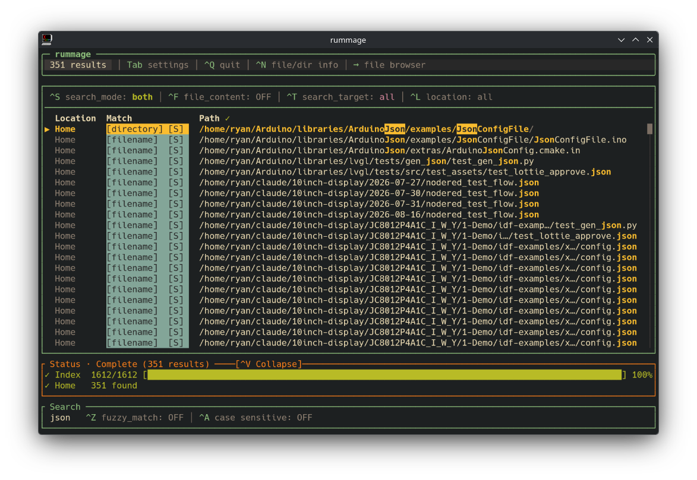
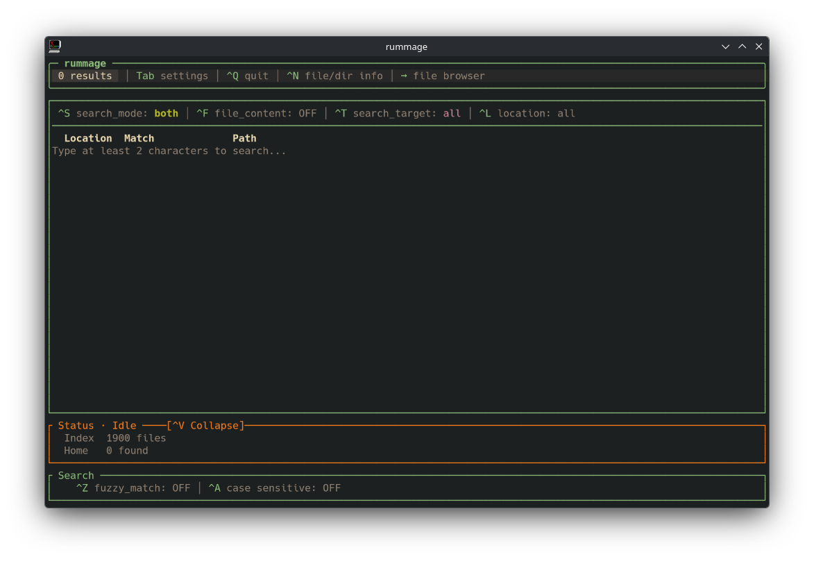

# rummage (`rum`)

A fast, fuzzy file finder with an interactive TUI and SSH support. Search local
and remote filesystems simultaneously, open results directly in your editor, and
browse the file tree — all from the terminal.



## Features

- **Fuzzy and consecutive matching** — standard fuzzy search or ordered-letter mode
- **Wildcard search** — use `*` and `?` for glob-style matching, auto-detected
- **Content search** — grep inside file contents locally and over SSH
- **SSH locations** — search remote filesystems transparently via SSH
- **File browser** — navigate directories from any search result
- **Index + live modes** — fast index search, live scan, or both together
- **Smart location filtering** — `^L` filters in-place when results are ready, restarts only when needed
- **CLI mode** — pipe results to other tools: `rum '*.rs' | xargs grep TODO`
- **Man page** — `man rum`

## Screenshots

**Idle — ready to search:**



**Search results — 351 matches for "json":**


## Installation

### NixOS (flakes)

Add rummage to your flake inputs and include it in your system packages:

```nix
# flake.nix
{
  inputs = {
    nixpkgs.url = "github:NixOS/nixpkgs/nixos-unstable";
    rummage = {
      url = "github:ryanbooker1/rummage";
      inputs.nixpkgs.follows = "nixpkgs";
    };
  };

  outputs = { nixpkgs, rummage, ... }: {
    nixosConfigurations.myhostname = nixpkgs.lib.nixosSystem {
      modules = [
        ({ pkgs, ... }: {
          environment.systemPackages = [
            rummage.packages.${pkgs.system}.default
          ];
        })
      ];
    };
  };
}
```

Then rebuild:

```bash
sudo nixos-rebuild switch --flake .#myhostname
```

You can also run it without installing:

```bash
nix run github:ryanbooker1/rummage
```

### NixOS (traditional configuration, no flakes)

Get the sha256 hash for the version you want:

```bash
nix-prefetch-url --unpack \
  https://github.com/ryanbooker1/rummage/archive/main.tar.gz
```

Add to your `/etc/nixos/configuration.nix`:

```nix
{ config, pkgs, ... }:

let
  rummage = pkgs.rustPlatform.buildRustPackage {
    pname = "rummage";
    version = "0.1.0";

    src = pkgs.fetchFromGitHub {
      owner  = "ryanbooker1";
      repo   = "rummage";
      rev    = "main";
      sha256 = "sha256-AAAAAAAAAAAAAAAAAAAAAAAAAAAAAAAAAAAAAAAAAAA=";
    };

    cargoLock.lockFile = "${src}/Cargo.lock";

    nativeBuildInputs = with pkgs; [ pkg-config ];
    buildInputs       = with pkgs; [ openssl libssh2 zlib ];

    PKG_CONFIG_PATH = pkgs.lib.makeSearchPathOutput "dev" "lib/pkgconfig"
      (with pkgs; [ openssl libssh2 zlib ]);

    postInstall = ''
      install -Dm644 man/rum.1 $out/share/man/man1/rum.1
    '';
  };
in
{
  environment.systemPackages = [ rummage ];
}
```

Then rebuild:

```bash
sudo nixos-rebuild switch
```

See [`configuration.nix.example`](configuration.nix.example) for a full annotated example including update instructions.

### Any Linux (via Nix package manager)

Install [Nix](https://install.determinate.systems) on any distro, then:

```bash
nix profile install github:ryanbooker1/rummage
```

### Arch Linux / Manjaro / Omarchy

Install dependencies:

```bash
sudo pacman -S pkg-config openssl libssh2
```

Install via Cargo:

```bash
cargo install --git https://github.com/ryanbooker1/rummage --bin rum
```

### Ubuntu / Debian

Install dependencies:

```bash
sudo apt install pkg-config libssl-dev libssh2-1-dev zlib1g-dev
```

Install via Cargo:

```bash
cargo install --git https://github.com/ryanbooker1/rummage --bin rum
```

### Fedora / RHEL / CentOS / Rocky Linux

Install dependencies:

```bash
sudo dnf install pkg-config openssl-devel libssh2-devel zlib-devel
```

Install via Cargo:

```bash
cargo install --git https://github.com/ryanbooker1/rummage --bin rum
```

### openSUSE

Install dependencies:

```bash
sudo zypper install pkg-config libopenssl-devel libssh2-devel zlib-devel
```

Install via Cargo:

```bash
cargo install --git https://github.com/ryanbooker1/rummage --bin rum
```

### Alpine Linux

Install dependencies:

```bash
sudo apk add pkgconf openssl-dev libssh2-dev zlib-dev musl-dev
```

Install via Cargo:

```bash
cargo install --git https://github.com/ryanbooker1/rummage --bin rum
```

### Installing Rust / Cargo

If you don't have Cargo installed, get it via [rustup](https://rustup.rs):

```bash
curl --proto '=https' --tlsv1.2 -sSf https://sh.rustup.rs | sh
```

## Usage

### Interactive TUI

```bash
rum
```

Type to search. Results appear as you type from the index; live searches
fill in new files after a short delay.

### CLI (non-interactive)

```bash
rum <query> [options]
```

Prints matching paths to stdout — no TUI, works in scripts and pipes.

```bash
rum main                        # find files matching "main"
rum '*.rs'                      # wildcard: all Rust source files
rum -m live main                # live scan only (bypass index)
rum -f TODO                     # search file contents for "TODO"
rum -c README                   # case-sensitive match
rum -t dirs src                 # directories only
rum -l work query               # restrict to the "work" location
rum -n 20 '*.toml'              # limit to 20 results
rum -0 '*.rs' | xargs -0 wc -l  # NUL-separated output for xargs
```

### CLI options

| Flag | Short | Default | Description |
|------|-------|---------|-------------|
| `--target` | `-t` | `all` | What to search: `files`, `dirs`, `all`, `content` |
| `--mode` | `-m` | `both` | Search mode: `index`, `live`, `both` |
| `--content` | `-f` | off | Also grep file contents |
| `--case-sensitive` | `-c` | off | Case-sensitive matching |
| `--fuzzy` | `-z` | on | Fuzzy matching (disable for consecutive/ordered) |
| `--location` | `-l` | all | Filter to one location by name or ID |
| `--limit` | `-n` | unlimited | Maximum results to print |
| `--null` | `-0` | off | NUL-separated output (for `xargs -0`) |

CLI defaults inherit from your saved TUI settings.

## Keyboard shortcuts

| Key | Action |
|-----|--------|
| `↑ / ↓` | Move through results |
| `Enter` | Open in editor |
| `Esc` | Clear query, cancel searches |
| `^F` | Toggle content search |
| `^T` | Cycle search target (files → dirs → all → content) |
| `^S` | Cycle search mode (index → live → both) |
| `^Z` | Toggle fuzzy / consecutive matching |
| `^A` | Toggle case-sensitive matching |
| `^L` | Cycle location filter |
| `^N` | File info popup |
| `^C` / `→` | Open file browser |
| `^R` | Rebuild index |
| `Tab` | Open settings popup |
| `^Q` | Quit |

Full reference: `man rum` or press `Tab` → Keys in the TUI.

## Configuration

Settings and locations are managed from the TUI (`Tab` to open settings).
Config is stored in `~/.config/rummage/config.toml`.

SSH passwords are stored separately — either encrypted
(`~/.config/rummage/credentials.enc`, requires a master password on
startup) or in a plain file with restricted permissions
(`~/.config/rummage/credentials.json`). Neither is ever written to disk
in a world-readable state. No credentials are stored in this repository.

SSH host keys are verified using trust-on-first-use (TOFU) and stored in
`~/.config/rummage/known_hosts`.

## Building from source

Requires Rust and the system libraries listed in the installation section above.

```bash
git clone https://github.com/ryanbooker1/rummage
cd rummage

# With Nix (recommended — handles all dependencies)
nix develop --command cargo build --release

# Without Nix (system deps must be installed manually)
cargo build --release
```

The binary is at `target/release/rum`. Copy it to anywhere on your `$PATH`.

## License

MIT
